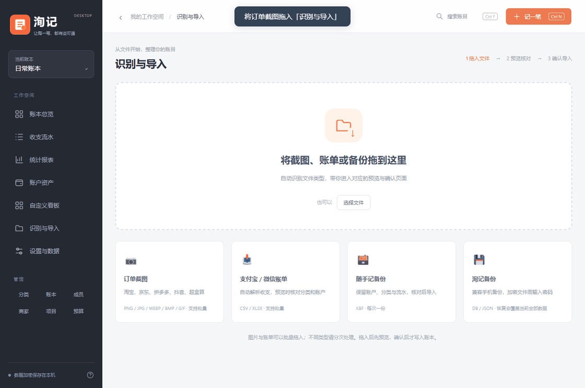
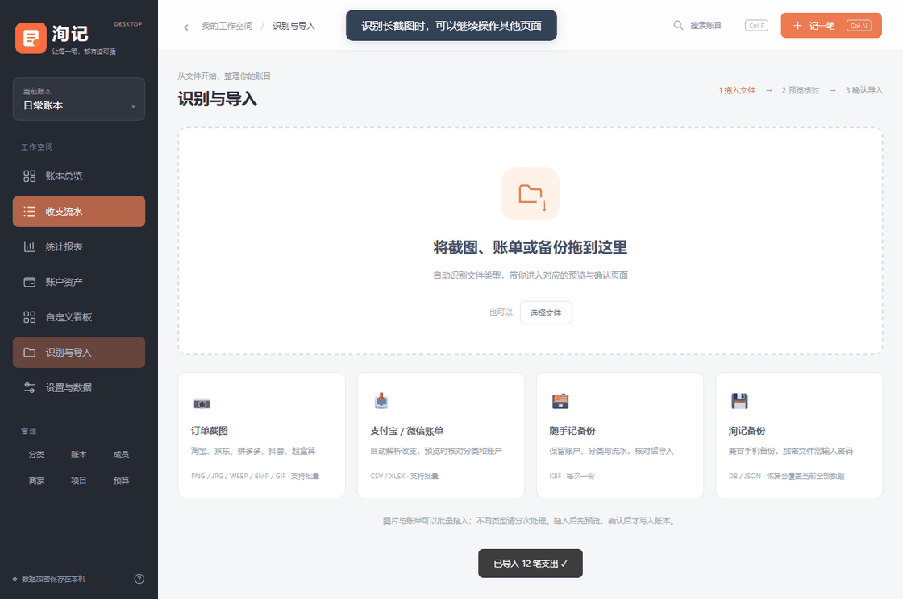
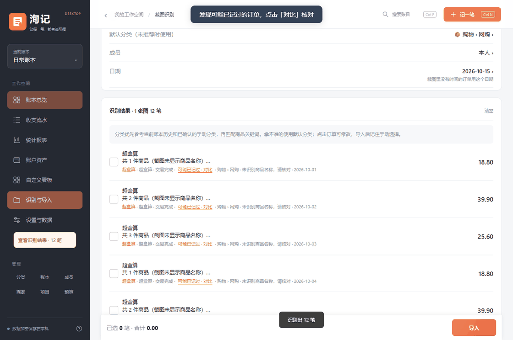

# 洵记 · Windows 桌面版

在电脑上记账、查看报表和整理订单截图。账本加密保存在本机，支持离线 OCR，无需注册。

**[下载桌面版 EXE](https://github.com/wsx1q/xunji/releases/tag/desktop-v20261016.2217)** · [使用与构建说明](desktop/README.md)

适用于 **Windows 10 / 11 x64**，需要 Microsoft Edge WebView2 Runtime。下载 `xunji-desktop-*.exe` 直接运行，内含识别模型，无需另外安装 Python 或启动 OCR 服务。

## OCR 功能演示

以下 GIF 录制自实际桌面界面和本机 OCR，使用虚构订单与空白演示账本。

### 拖入截图，识别后确认导入

把订单截图拖进导入页，查看识别进度，核对金额、日期、账户和分类后再导入。支持批量图片和长截图，多件商品合单按实际支付总额记一笔。

### 切换页面，后台继续识别

识别过程中可以继续查看账本。右下角显示后台任务，完成后可返回结果；点“稍后查看”后，左侧仍保留入口。

### 可能重复的记录，与已有账目对比

并排核对金额、日期、账户、分类和完整备注，差异字段标色，多笔匹配可以切换。确认后决定本条不导入，或仍选中待导入；已有账目不会被修改。

## 桌面功能

- **账务**：支出、收入、转账，多账本和二级账户；分类多选、成员、商家、项目管理；管理列表点击看流水，长按或右键编辑。
- **电脑操作**：侧边导航、表格流水、键盘快捷键、右键编辑、拖动排序和批量修改。
- **报表与看板**：分类构成、收支趋势、预算与自定义看板，支持月报、年报和全部时间，明细可展开收起；首页收支、预算、趋势、资产和各看板均可进入对应流水。
- **文件导入**：拖入支付宝 / 微信账单、随手记 KBF 或洵记备份，先预览再确认。
- **截图识别**：淘宝、京东、拼多多、抖音、超盒算；金额、时间和商品明细写入预览。超盒算只有商品图片时保留件数，不猜测名称。
- **核对处理**：退款默认不导入，可编辑、纠正和批量忽略；不完整订单提示补图。
- **本地分类推荐**：根据商品、已有分类和确认过的记录推荐，不拆分订单金额。
- **数据保护**：加密账本、自动备份、密码 / Windows Hello 解锁，可与手机版交换加密备份。

本机 OCR 仅在需要时加载，闲置后释放模型。普通记账不预热模型，识别时可以离开当前页面。尚未导入的预览只保留在本次运行中，退出前请确认导入。

## 数据与备份

默认数据目录为 `%LOCALAPPDATA%\XunJiDesktop`。删除或替换 EXE 不会删除账本；自动备份保留最近 5 份。可在设置中更改数据库位置、导出加密备份或恢复数据。

本机账务与本机 OCR 不上传数据。只有主动配置远程 OCR 服务时，才会将截图发送给配置的服务。密码无法找回，请妥善保留加密备份和密码。

## 源码

此分支仅维护桌面版：`desktop/` 是 Windows 宿主与界面，`web/` 是桌面加载的账务和页面源码，`tests/` 是回归用例，`tools/` 是构建清理与演示录制工具。构建不依赖 Android 工程或独立 OCR 服务工程。

构建步骤见 [desktop/README.md](desktop/README.md)。非必要不重复打包 EXE，默认只生成带版本号的文件，保留最新和前一个版本。

## 许可证

[GPL-3.0](LICENSE)
