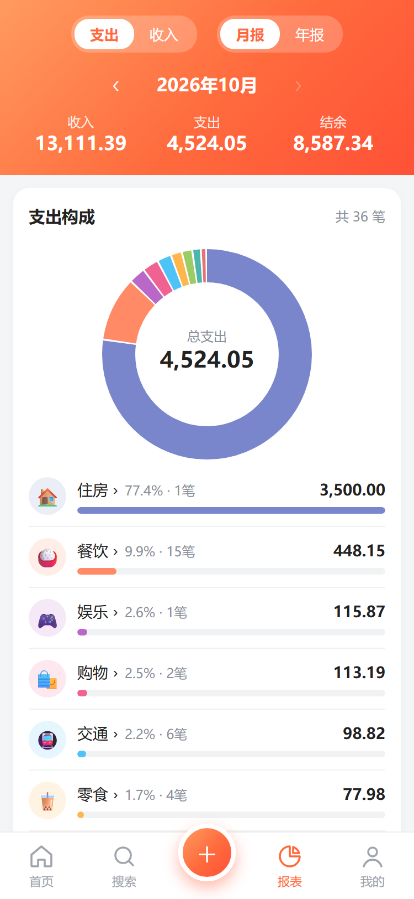
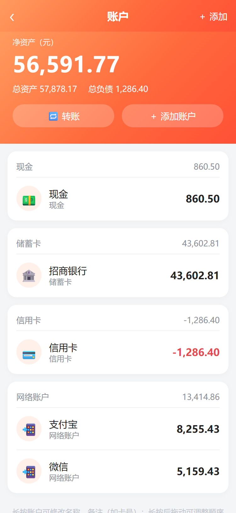
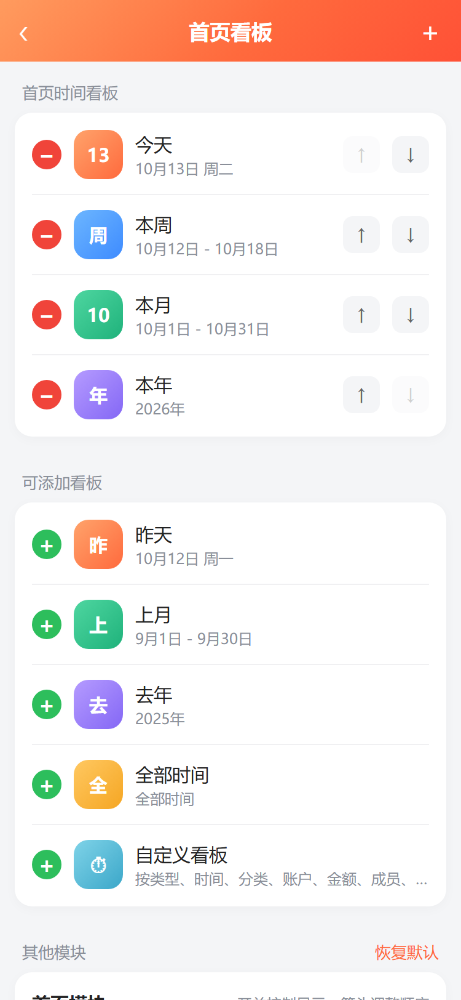

# 洵记

一个不联网、不用注册的 Android 记账 App。账目加密后只存在你自己的手机上。

  
  
  

  
  
  

截图为示例数据。

## 能做什么

- **记账**：支出 / 收入 / 转账，二级分类，金额可以直接算（`12+8.5`），记住上次用的账户和分类
- **账户**：现金、银行卡、支付宝、微信、信用卡……支持子账户，余额对不上可以直接调整
- **多账本**：日常、旅行、装修分开记
- **报表和预算**：支持月报、年报和全部时间；分类多选使用明显的底色、边框和勾选状态。分类构成、每日趋势、近 6 个月对比；每月总预算和分类预算
- **自定义首页**：按项目、成员、账户、时间段等条件建统计看板
- **导入**：支付宝 / 微信账单文件、官方「随手记」本地备份（.kbf）；导入后可以合并重复的分类和账户
- **截图识别**（OCR 版）：选淘宝 / 京东 / 拼多多 / 抖音的订单截图，自动识别金额，在手机上离线完成
- **安全**：数据 AES-256 加密，密码 / 指纹解锁，自动备份，加密备份可以换机恢复

## 下载

到 [Releases](https://github.com/wsx1q/xunji/releases) 下载最新的 APK，需要 Android 7.0 及以上。

| 版本 | 大小 | 适合 |
|---|---|---|
| `xunji-*.apk` 正式版 | 约 150 KB | 日常使用 |
| `xunji-ocr-*.apk` OCR 版 | 约 30 MB | 想用订单截图识别 |

两个版本可以同时安装，数据互不相通。

## 你的数据

- **不联网、不上传**：正式版连网络权限都没有申请。
- **加密保存**：数据库文件始终是加密的，别的 App 和拿到文件的人都看不了。
- **密码无法找回**：设了密码一定要记牢，忘了数据就打不开了。
- **换手机前先备份**：卸载 App 会删除 App 里的数据。换手机或重装前，在「我的 → 备份与恢复」导出加密备份，新手机上「从文件恢复」并输入密码即可。也可以在「我的 → 数据库位置」把数据库放到网盘同步的文件夹里。

## 使用说明

见 [使用说明](docs/使用说明.md)，App 里「我的 → 使用说明」也有一份。

## 参与开发

见 [开发说明](docs/开发说明.md)。

## 许可证

[GPL-3.0](LICENSE)：可以自由使用、修改和再发布，修改后发布的版本也需要以 GPL-3.0 开源。
