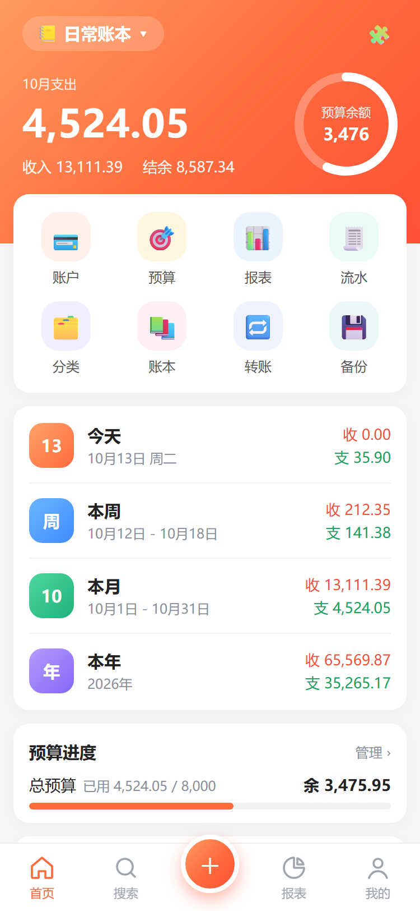
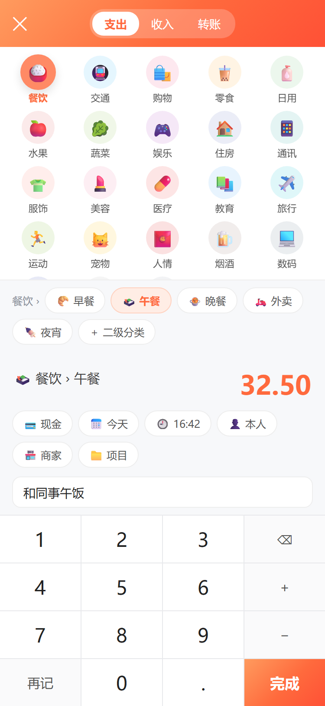
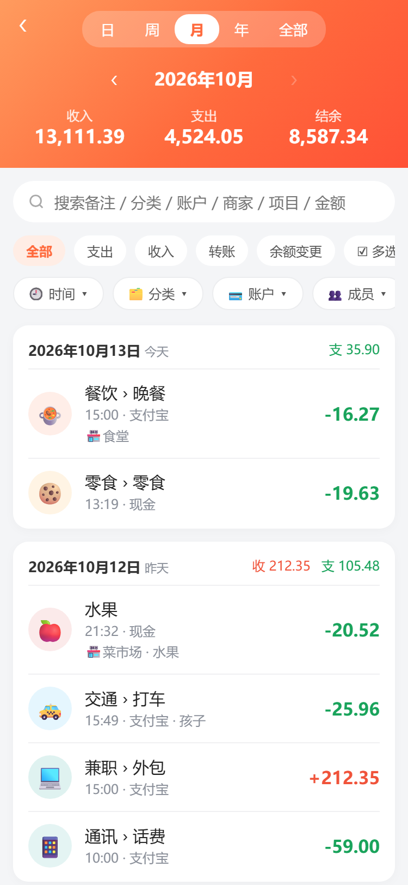

# 洵记使用说明

洵记是一个离线记账 App：不用注册、不联网，所有数据加密后只存在你的手机上（或你指定的文件夹里）。
第一次打开是一个空账本，里面已经有常用的收支分类和一个余额为 0 的「现金」账户，直接就能开始记。

App 里也有一份简版说明：**我的 → 使用说明**。

  
  
  

## 1. 先把账户建好

账户就是钱放的地方：现金、银行卡、支付宝、微信、信用卡……

1. 首页快捷入口点 **账户**（或 **我的 → 账户管理**），右上角 **＋ 添加**。
2. 选类型、填名称和**当前余额**。信用卡欠款填负数，比如欠 2000 填 `-2000`。
3. 备注里可以写卡号后几位、开户行，方便区分。

- **子账户**：比如「微信」下面分「零钱」「零钱通」。在账户详情里点 **＋ 子账户**，上级账户显示的是合计余额。
- **余额对不上**：进账户详情点 **调整余额**，直接改成实际余额，可以顺便填上调整原因（比如「现金盘点」「漏记」）。洵记会自动补一条「余额变更」记录，它不算进收支报表；之后点这条记录还能修改备注。
- **改名 / 排序**：在账户列表里长按账户可以改名，长按后拖动可以调整顺序。

## 2. 记一笔

点底部中间的 **＋**。

1. 上面选 **支出 / 收入 / 转账**。
2. 点分类图标，下面一行会出现它的二级分类（比如餐饮 → 早餐、午餐）。不选二级分类也可以。
3. 用键盘输入金额，可以直接算：`12+8.5-3`，按 **=** 算出结果，再按 **完成** 保存。输错了按 **AC** 一键清空。
   开头先按 **−** 可以输入负数，比如退款可以记成一笔负的支出，支出合计会相应减少。
4. 键盘上面那排可以改账户、日期、时间、成员、商家、项目，也可以写备注。
5. **再记** 保存后不退出，接着记下一笔。

洵记会记住你上次用的账户、分类和成员，下次直接带出来。

- **转账**（比如银行卡转到微信、还信用卡）：选 **转账**，选转出、转入账户。转账不算收入或支出，只改变两个账户的余额。
- **改分类**：在记账页点分类区最后的 **设置**，或者 **我的 → 分类管理**。分类管理和记账页是同样的图标网格：点一级分类，下面展开它的二级分类；图标右上角的数字是记录笔数，没有记录的分类点「删除」会直接删掉。
  全 App 通用一个规则：**短按是选择，长按是编辑**。分类、账户、成员、商家、项目，不管在记账页的选择列表、分类管理还是流水筛选里，长按都能改名、删除、合并，长按后拖动可以排序。

## 3. 查账、改账

- **流水**：首页快捷入口点 **流水**，或点首页时间看板里的「今天 / 本月 / 本年」。上面可以按日 / 周 / 月 / 年 / 全部切换；**点中间的年月可以直接选年份和月份**，也可以按左右箭头一个月一个月翻。下面的筛选栏可以按分类、账户、成员、商家、项目、金额、备注筛选，金额里有「小于 0」可以只看负数记录。
- **搜索**：底部 **搜索**，能搜备注、分类、账户、商家、项目和金额。点搜索框会显示最近搜过的 8 个关键词，点一下直接再搜，点关键词右上角的 ✕ 可以单独删掉。
- **返回键**：在搜索、报表、我的页面里，按返回会一层层退回到这个页面本身，不会跳回首页。
- **修改 / 删除**：点一条记录进入编辑；或者向左滑，出现 **复制 / 编辑 / 删除**。「复制」会带着同样的分类和金额新记一笔，适合每天都一样的开销。
- **批量修改**：在流水页长按一条记录或点 **☑ 多选**，选好后点 **批量修改**：可以一次改分类、账户、成员、商家、项目，给备注追加文字（原备注保留），删掉备注里的某段文字（其余保留），或者批量删除。适合导入后整理：先用搜索 / 筛选把要改的记录找出来，全选，再一次改好。改完可以撤销。
- 搜索和备注筛选里的英文**不分大小写**。

## 4. 报表和预算

- **报表**：底部 **报表**，可以切支出 / 收入、月报 / 年报，点中间的年月可以直接选。环形图下面点带 › 的分类可以看它的二级分类构成，再点一次看明细。下面还有每日趋势和近 6 个月收支对比。
- **预算**：首页快捷入口点 **预算**，设置每月总预算，也可以给单个分类设预算。首页右上角的圆环显示本月还剩多少。

## 5. 定制首页

点首页右上角的 **🧩**：

- **时间看板**：首页那几行「今天 / 本周 / 本月 / 本年」，可以增删、调整顺序，也能加「昨天」「上月」「去年」。
- **自定义看板**：按条件统计，比如「装修」项目的总花费、某个成员这个月的支出、某张卡的流水。在流水页筛选好以后，点筛选栏最后的 **⭐ 存为看板** 也能直接建。
- **首页模块**：预算进度、支出排行、近 7 日支出、资产概览、成员支出、最近记录，可以开关和排序。
- **快捷入口**：首页上面那排图标，最多选 12 个。

## 6. 从别的地方导入

**支付宝 / 微信账单**（我的 → 导入支付宝 / 微信账单）

- 支付宝：我的 → 账单 → 右上角 ⋯ → 开具交易流水证明 → 用于个人对账，发到邮箱后解压得到 CSV 文件。
- 微信：我 → 服务 → 钱包 → 账单 → 下载账单 → 用于个人对账，得到 xlsx 文件。
- 也可以在微信或文件管理里点开账单文件，选「用其他应用打开」→ 洵记。

读取后会自动猜分类、按付款方式对应到你的账户，可以逐条修改。退款、交易关闭这类不计收支的记录默认不导入；和已有记录金额、时间很接近的会标成「可能重复」，默认不勾选。同一份账单重复导入会自动跳过已导入的记录。

**随手记备份**（我的 → 导入随手记备份）

选随手记 App 导出的本地备份 `.kbf` 文件。账户、分类、成员、商家、项目和全部流水都会导进来，导完会核对每个账户的余额是不是和随手记一致。可以导到当前账本，也可以导到一个新的「随手记」账本。

**识别订单截图**（只有洵记OCR版有）

选淘宝 / 京东 / 拼多多 / 抖音「我的订单」列表的截图，可以一次选多张，自动识别出每笔订单的金额。退款和已关闭的订单不计入。识别在手机上离线完成，也可以切到「电脑识别」用电脑上的 OCR 服务。

**整理导入后的数据：合并**

导入后经常会出现重复的账户（「现金」和「现金（随手记）」）、名字不同但意思一样的分类、多余的账本。用 **合并** 整理，所有相关记录会自动一起改，不用一条条修改：

- **分类**：我的 → 分类管理，点分类 → **合并到…** → 选目标分类。合并一级分类时，同名的二级分类会合并，其余二级分类一起搬过去；预算也会加到目标分类上。
- **账户**：长按账户（或进账户详情点「编辑」）→ **合并到…**。记录全部转到目标账户，余额相加；两个账户之间的转账会互相抵消、自动删掉。
- **账本**：我的 → 账本管理 → 点账本 → **合并到…**，记录全部移到目标账本。
- **成员 / 商家 / 项目**：在管理列表里点一下 → **合并到…**；改名时改成已有的名字也是合并。

合并前会提示有多少条记录会被改动。合并完成后可以马上点 **撤销合并**，或者稍后在 **我的 → 撤销上一次合并** 撤销，恢复到合并前的样子。只能撤销最近的一次；合并之后如果又改过数据（比如记了一笔）或者重启了 App，就不能撤销了。大批整理前仍建议先导出一份备份。

## 7. 密码、备份和换手机（重要）

**设置密码**：我的 → 密码。这个密码有两个用处：

- 打开 App 时要输入（可以关掉；开着时还能用指纹解锁）；
- 换手机、重装或在别的设备上打开数据库和备份文件时要用。

**密码忘了就找不回来，数据也就打不开了，一定要记牢。**

**自动备份**：我的 → 备份与恢复，选备份频率。自动备份存在 App 里面，最多保留 5 份，**卸载 App 会一起删除**，所以它只能防误操作，防不了丢手机或者卸载。

**换手机 / 重装前**，任选一种：

- **导出加密备份**：我的 → 备份与恢复 → 导出加密备份。文件保存在手机的 `Download/XunJi/` 里，把它拷到电脑或网盘。新手机装好洵记后，选 **从文件恢复**，输入密码。
- **把数据库放到自己的文件夹**：我的 → 数据库位置 → 选择存放目录，比如选一个会同步到网盘的文件夹。以后每次记账都直接保存到那里。换手机后在同一个位置选这个文件夹，输入密码就能接着用。

**导出 Excel**：我的 → 导出 Excel (CSV)，导出全部流水，用 Excel 或 WPS 打开。

## 8. 其他

- **多个账本**：首页左上角点账本名切换，或 **我的 → 账本管理** 新建（比如旅行账本、装修账本），在账本管理里点账本也能切换。账户是所有账本共用的。
- **成员 / 商家 / 项目**：记账时可选的标签，在 **我的** 里分别管理，名字后面的数字是记录笔数。点一下可以改名、删除、合并，已有记录里的名字会一起改。
- **收支颜色**：默认红色是收入、绿色是支出，在 **我的 → 收支颜色** 可以反过来。
- **清空所有数据**：我的 → 清空所有数据，回到第一次打开时的空账本（密码保留）。清空前建议先导出一份备份。
